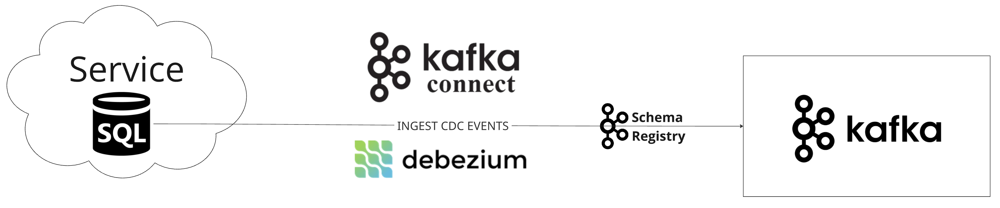

# Kafka Connect
Project to showcase how to capture CDC events from a database and ingest them to Kafka.

Tech stack: Kafka Connect, Debezium and PostgreSQL.

A [Docker Compose file](docker-compose.yml) is provided that spins up containers for Kafka, Schema Registry, Kafka Connect and PostgreSQL.

Run `make help` to see available commands to run the project.

Kafka topics can be browsed with Kafbat UI (http://localhost:8080) after spinning up the services.

## Dependency management
Dependabot is configured to periodically upgrade repo dependencies. See [dependabot.yml](.github/dependabot.yml).
